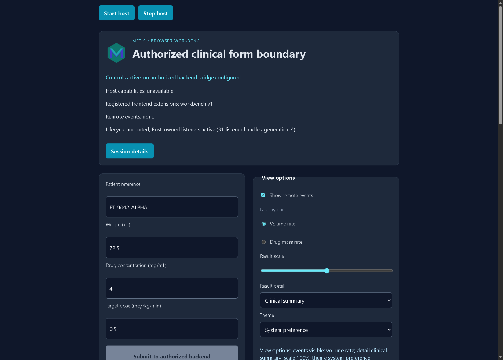
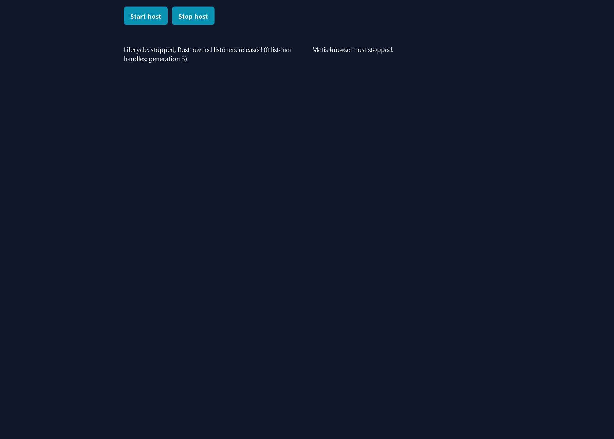

# Browser cross engine

[Browser manual](../browser.md)


## Run the cross-engine conformance trace

The repository includes a dependency-free W3C WebDriver runner. It uses the
same Rust/WASM page and scenario for Chromium, Firefox and WebKit, then writes
one schema-1 JSON trace at `output/browser/runtime/<engine>-<scenario>.json` and PNG
screenshots under `output/browser/runtime/screenshots/<engine>/`. The browser
and its WebDriver endpoint are host or CI prerequisites; the runner does not
install a driver or add a JavaScript test runtime. Configure one endpoint per
engine, for example:

```powershell
$env:METIS_WEBDRIVER_CHROMIUM_URL = "http://127.0.0.1:9515"
$env:METIS_WEBDRIVER_FIREFOX_URL = "http://127.0.0.1:4444"
$env:METIS_WEBDRIVER_WEBKIT_URL = "http://127.0.0.1:4444"
```

Chromium-family drivers may select a different W3C browser name. This is
needed for Microsoft Edge, whose driver rejects the default `chrome` name;
the engine remains `chromium` because the browser uses the Chromium protocol:

```text
python scripts/browser_runtime.py --engine chromium --browser-name MicrosoftEdge --driver-url http://127.0.0.1:9517 --serve-dir output/browser --bridge disconnected
```

The override is validated against the selected engine. `firefox` accepts only
`firefox`, `webkit` accepts only `safari`, and Chromium accepts `chrome` or
`MicrosoftEdge`.

The inspected Edge workbench capture is preserved in the [sanitized trace](../images/metis-browser-edge-workbench.json). It records the two input mutations, the disabled privileged action, stop/remount state and JavaScript heap observations without retaining driver process paths. The remounted view is the final state after the old controls were released:



The same workbench now has a live four-cycle Edge capture at Metis revision
`012ed7175268c283cb4b8cbd617f1a138d955532`. Each cycle stopped the Rust/WASM
mount, released all 27 controls and 31 Rust-owned listener handles, then
remounted a fresh generation with the same positive counts. The disconnected
bridge stayed disabled, the session ended with zero pending requests, and the
WebDriver session closed cleanly. The [sanitized lifecycle trace](../images/metis-browser-edge-lifecycle.json)
contains the exact state transitions, heap observations and screenshot hashes.





The input-change states are also preserved as [after-weight](../images/metis-browser-edge-lifecycle-after-weight.png)
and [after-dose](../images/metis-browser-edge-lifecycle-after-dose.png) captures.

Run the disconnected format-neutral workflow against the generated assets:

```text
python scripts/browser_runtime.py --engine chromium --serve-dir output/browser --bridge disconnected
python scripts/browser_runtime.py --engine firefox --serve-dir output/browser --bridge disconnected
python scripts/browser_runtime.py --engine webkit --serve-dir output/browser --bridge disconnected
```

Each command fails if its endpoint is missing, the page does not mount the
Rust-owned form, either of the two input changes is not reflected in the DOM,
or the stop/remount generation retains application controls or an old result.
The semantic snapshot also records the visible lifecycle status, the
`data-metis-listener-count` and `data-metis-generation` root attributes, and
requires stop to report zero Rust-owned listener handles before remount reports
a positive count on a newer generation.
Waits run inside the browser with a `MutationObserver` or one bounded timer;
the host does not sleep or poll. The trace includes the negotiated browser
capabilities, exact actions and observed values, semantic snapshots, screenshot
hashes/dimensions, the three explicitly unsupported native operations and
cleanup evidence. Review the screenshots and the semantic states together.

Use `--device-scale` to request a bounded high-DPI browser session. The value
is fixed-point decimal text between `0.5` and `4`; the trace records both the
requested value and the browser's effective `devicePixelRatio` and CSS viewport:

```text
python scripts/browser_runtime.py --engine chromium --browser-name MicrosoftEdge --driver-url http://127.0.0.1:9517 --serve-dir output/browser --bridge disconnected --device-scale 2
```

Chromium and Edge receive their native scale-factor launch option, while
Firefox receives `layout.css.devPixelsPerPx`. WebKit has no WebDriver scale
override and rejects values other than `1`, so an unsupported high-DPI claim
cannot pass silently. The same option is available on the canvas, fragment and
file-backed gallery runners; RITK still owns DICOM decoding and all image
assertions.

### Probe runtime accessibility semantics

Add `--accessibility-probe` to a workbench run to record the browser's observed
media preferences, CSS and visual viewport, document extents, focus order and
focusable-element geometry in `metrics.accessibility`. The probe focuses each
enabled, visible control in DOM order with `preventScroll`, checks that the
sequence matches the DOM order, then blurs the control before returning the
trace. It rejects duplicate identities, empty or off-viewport rectangles and
horizontal document overflow. The probe records labels and roles only; it does
not copy form values or DICOM/patient content.

Run it against the generated workbench with the same bounded device scale used
by the cross-engine trace:

```text
python scripts/browser_runtime.py --engine chromium --browser-name MicrosoftEdge \
  --driver-url http://127.0.0.1:9517 --serve-dir output/browser \
  --bridge disconnected --device-scale 2 --accessibility-probe \
  --lifecycle-cycles 4 --output output/browser/runtime/chromium-accessibility.json
```

For the authorized workbench, add `--keyboard-submit` to exercise completion
without a pointer. The flag requires `--accessibility-probe` and
`--bridge authorized`; the runner focuses the first observed enabled control,
sends bounded `Tab` actions until `submit-calculation`, sends `Enter`, waits
for the real backend result, and records the focus path plus an
`after-keyboard-submit` semantic snapshot. A missing, disabled or
out-of-order submit target fails closed. This is browser DOM keyboard evidence;
it does not claim spoken screen-reader output or an operating-system
accessibility bridge.

The optional `--require-reduced-motion` and `--require-forced-colors` switches
turn the corresponding `matchMedia` observation into an acceptance condition;
they require `--accessibility-probe` and fail when the driver host has not
enabled that preference. The default matrix records each engine's actual
preference state without pretending to control operating-system settings.
Review the accessibility records with the PNG captures: CSS geometry and a
semantic focus path establish browser behavior, while spoken screen-reader
output, installed IME behavior and the native host accessibility bridge still
require host-specific acceptance evidence.

The protocol client also provides the format-neutral physical-input seam used
by application-owned canvas scenarios. A consumer resolves its canvas element
through WebDriver and sends trusted pointer and wheel actions without placing
application state in Métis:

```python
from scripts.browser_protocol import WebDriverClient

client.pointer_drag(canvas_element_id, (24, 24), (64, 48))
client.wheel(canvas_element_id, (64, 48), (0, 120))
client.release_actions()
```

The canvas trace snapshots each element's CSS dimensions before dispatch and
derives the element-local offsets from those dimensions. The WebDriver element
origin is the canvas center, so the runner clamps each requested point to
`floor(css_size / 2) - 1` on each axis. This keeps pointer and wheel events
inside short letterboxed canvases as well as full-sized surfaces; the trace
records the effective offsets. The client also bounds wheel deltas,
action-source count, per-source action count and serialized request size. RITK
owns the DICOM workflow and interprets these format-neutral events; Métis
records transport and screenshot evidence only. A configured engine endpoint is
required before the action trace can claim Chromium, Firefox or WebKit
evidence.

### Run the hosted cross-engine matrix

The same trace runs in the scheduled or manually dispatched `Metis verification`
workflow. The `browser-assets` job builds the locked Rust/WASM page once, then
the `browser-runtime` matrix runs it with the preinstalled Chromium and Firefox
drivers on Ubuntu and Safari's WebDriver on macOS. Chromium and Firefox run the
workbench at device scale `2`; Safari runs the explicitly supported scale `1`.
The hosted images provide the
browser/driver pair; see the [Ubuntu runner image inventory](https://github.com/actions/runner-images/blob/main/images/ubuntu/Ubuntu2404-Readme.md)
and [Apple's WebDriver setup](https://developer.apple.com/documentation/safari-developer-tools/macos-enabling-webdriver).
Safari automation is enabled explicitly with `sudo -n /usr/bin/safaridriver --enable`;
the hosted runner supplies passwordless elevation for this system setting, so no
registry or signing credential is involved. Each matrix job waits up to twenty
seconds for the driver's `/status` response before creating a session, and
each WebDriver request has a sixty-second bound for the slower Firefox launch.

Dispatch the workflow from a checked-out repository with the GitHub CLI:

```text
gh workflow run ci.yml --ref main
gh run list --workflow ci.yml --limit 1 --json databaseId,status,conclusion,headSha
```

The run produces one `metis-browser-runtime-<engine>-<run-id>` artifact for
each engine. Each artifact contains the schema-1 lifecycle trace and the PNGs
captured from the running browser window. A successful matrix is the evidence
for the three configured engines; a local Edge or Chromium capture remains a
separate single-engine observation. The jobs are schedule/manual only so a
pull request's Windows gate remains within its normal verification budget.

Hosted dispatch `34759186816` at Metis revision
`67689e5001f65d22ac388397442eb99df9bfe0ef` passed all three runtime jobs. The
[Chromium artifact](https://github.com/ryancinsight/metis/actions/runs/34759186816/artifacts/10318696257)
used Chrome 152.0.7977.82 and emitted five 1050×637 PNGs; the
[Firefox artifact](https://github.com/ryancinsight/metis/actions/runs/34759186816/artifacts/10318098189)
used Firefox 155.0 and emitted five 1152×635 PNGs; the
[Safari/WebKit artifact](https://github.com/ryancinsight/metis/actions/runs/34759186816/artifacts/10317374757)
used Safari 26.6.2 and emitted five 1024×674 PNGs. Every trace records the
two input changes, four stop/remount cycles, zero stopped listeners, 31
remounted listeners, zero pending requests and `session_closed: true`. Firefox
and WebKit correctly report JavaScript heap observations as unavailable rather
than fabricating values; Chromium records its bounded `performance.memory`
observations. The [workflow run](https://github.com/ryancinsight/metis/actions/runs/34759186816)
also retains the single [asset artifact](https://github.com/ryancinsight/metis/actions/runs/34759186816/artifacts/10318272226)
consumed by all three jobs.

### Run a consumer-owned canvas trace

The same runner has a canvas scenario for an application that owns one or more
HTML5 canvases. It captures the full browser window and each named canvas,
records its intrinsic and CSS dimensions, sends one trusted pointer drag and
wheel action to each element, and releases all WebDriver input sources before
closing the session. The trace keeps the Metis revision and the optional
consumer revision separate; the consumer revision must be a 40-hex Git
revision when supplied.

For the RITK browser viewer, run the page that mounts the RITK-owned canvases
and pass their IDs. The runner has no DICOM knowledge and does not interpret a
slice, voxel, series or medical state:

```text
python scripts/browser_runtime.py --scenario canvas --engine chromium --url http://127.0.0.1:8080/ritk.html --consumer-revision <RITK-40-HEX> --canvas-id ritk-snap-axial --canvas-id ritk-snap-coronal --canvas-id ritk-snap-sagittal
```

Consumers may add a bounded `--canvas-attribute data-*` argument for each
opaque DOM attribute they own. The runner records the requested values under
each canvas snapshot, uses `null` when an attribute is absent, and never
interprets the name or value. At most 16 names are accepted and each returned
value is limited to 1024 UTF-8 bytes. This lets a consumer such as RITK carry
its own semantic evidence without moving that meaning into Metis:

```text
python scripts/browser_runtime.py --scenario canvas --engine chromium --url http://127.0.0.1:8080/ritk.html --consumer-revision <RITK-40-HEX> --canvas-id ritk-snap-axial --canvas-id ritk-snap-coronal --canvas-id ritk-snap-sagittal --canvas-attribute data-ritk-load-state --canvas-attribute data-ritk-frame-state --canvas-attribute data-ritk-axis --canvas-attribute data-ritk-slice-index --canvas-attribute data-ritk-slice-count --canvas-attribute data-ritk-frame-width --canvas-attribute data-ritk-frame-height
```

Repeat the command for `firefox` and `webkit` with their configured driver
endpoints. The resulting schema-1 trace uses `bridge: "canvas"`, records
`consumer_revision`, stores both window and element PNG hashes, and records
the requested opaque attributes under each canvas snapshot. RITK remains
responsible for the DICOM byte drop, viewer reducer, axis/slice assertions and
the clinical visual oracle. A
missing driver endpoint is an unfulfilled evidence requirement, not a passing
or skipped engine result.

### Opt into an explicit WebGPU canvas

The browser host exposes the same frame and input contract over an explicit
WebGPU surface. A consumer selects it asynchronously at its presentation
boundary:

```rust,no_run
let surface = metis_web::CanvasSurface::from_current_document_gpu_with_input(
    "viewer",
)
.await?;
surface.present(&frame)?;
```

The constructor returns a typed unsupported or setup error when the browser
cannot provide a WebGPU adapter, device or context. It never changes a GPU
request into the raster provider, so a comparison can distinguish capability
failure from a successful raster run. The borrowed RGBA8 frame validation,
bounded pointer/wheel/keyboard queue and listener teardown are shared with the
existing two-dimensional constructor. After a device or swap-chain loss, the
consumer can explicitly reacquire the provider without rebuilding the canvas or
its listeners:

If a consumer has physical display geometry, its `CanvasFrame` implementation
may return a validated `DisplaySpacing` created with
`DisplaySpacing::try_new(row, column)`. `CanvasSurface::present` checks the
resulting positive finite aspect against the frame dimensions before the
provider upload. Pixel-only frames keep the default `None`; Metis does not
derive or interpret format-specific geometry.

```rust,no_run
surface.recreate().await?;
surface.present(&frame)?;
```

Recovery keeps the previous provider handles when setup fails and never changes
the requested GPU surface to raster presentation. A real adapter/device,
recovered visual output after device loss and GPU/resource measurements require
a consumer-owned browser run; the current RITK galleries remain the 2D visual
baseline.

The file-backed runner's default `--canvas-capture rgba` mode reads exact
two-dimensional canvas pixels. A consumer using another canvas context selects
the bounded element-PNG mode and names the context explicitly:

```text
python scripts/browser_drop.py --driver-url http://127.0.0.1:9515 \
  --engine chromium --input chooser --canvas-capture screenshot \
  --canvas-context webgpu --page-query renderer=webgpu \
  --files <study-directory> --pattern '*.dcm' \
  --oracle <consumer-oracle.json> --consumer-revision <CONSUMER-40-HEX>
```

Screenshot mode verifies the consumer's intrinsic canvas dimensions, confirms
that the named context exists, writes the real element PNG, and records its
digest and dimensions. It does not reinterpret the pixels or claim equivalence
with an RGBA readback; the consumer owns the visual oracle and any comparison
against its decoded frame. Repeated lifecycle mode remains available for the
RGBA contract; screenshot mode is a single bounded lifecycle so an unchanged
element digest can be checked after rejection probes.

Before every element PNG, the runner centers the named canvas in the browser
viewport and verifies that its complete CSS rectangle is visible. A driver that
would clip the element instead produces a bounded failure, so the recorded PNG
dimensions remain the canvas CSS box multiplied by the measured device scale.
It then waits for two animation frames before reading the element. This covers
responsive reflow and queued presentation work without a wall-clock sleep;
hidden documents, unavailable animation callbacks and a 2,000 ms settle
deadline fail closed with a diagnostic.

For an Edge canvas run, keep `--engine chromium` and add the same browser-name
override:

```text
python scripts/browser_runtime.py --scenario canvas --engine chromium --browser-name MicrosoftEdge --driver-url http://127.0.0.1:9517 --url http://127.0.0.1:8080/ritk.html --consumer-revision <RITK-40-HEX> --canvas-id ritk-snap-axial --canvas-id ritk-snap-coronal --canvas-id ritk-snap-sagittal
```

Each canvas trace also installs a bounded capture-phase observer for the four
input event kinds used by the scenario. The pointer and wheel action records
include the observed event type, `isTrusted` value and target canvas; every
observed event must be trusted and targeted to the requested canvas. The
observer consumes at most 32 records per canvas and is removed before the final
window capture. This proves the browser transport delivered trusted events and
that the runner released its own diagnostic listeners; provider-private
listener registries remain outside WebDriver's contract.

For the authorized service path, keep the static server and service running,
then pass the host-provided session tuple in the URL. The runner validates the
`ws`/`wss` endpoint, decimal process identifier and 32-hex-digit principal
before navigation:

```text
python scripts/browser_runtime.py --engine chromium --driver-url http://127.0.0.1:9515 --url "http://127.0.0.1:8080/?endpoint=ws%3A%2F%2F127.0.0.1%3A8765%2Fsocket&process=42&principal=66666666666666666666666666666666" --bridge authorized
```

The query separators in a shell URL must remain `&`; the encoded endpoint is
shown only so the WebSocket value stays one query field. The authorized trace
waits for **Authorized backend session ready**, submits the real service
request, and asserts `Volume rate: 0.900000 mL/hr`. Add `--cancel` while the
service is running with `--response-delay-ms 4000` to stop and remount during a
pending response; the delayed response must not change the new generation:

```text
python scripts/browser_runtime.py --engine chromium --driver-url http://127.0.0.1:9515 --url "http://127.0.0.1:8080/?endpoint=ws%3A%2F%2F127.0.0.1%3A8765%2Fsocket&process=42&principal=66666666666666666666666666666666" --bridge authorized --cancel --cancel-grace-ms 4500
```

The browser runner does not open native file dialogs, launch native processes,
grant operating-system permissions or parse DICOM. RITK owns DICOM opening,
series selection, decoding, geometry and viewer state; see the
[RITK DICOM workflow manual](https://github.com/ryancinsight/ritk/blob/main/docs/manual/dicom-workflow.md). The
runner's cleanup statement means that the stopped DOM has zero mounted
controls, the remounted form reports `aria-busy=false`, and no stale completion
appears after remount. Provider-private
listener registries, OS handles, installed IMEs and post-drop allocations
require their owning Moirai/RITK/native evidence and are not inferred from a
browser screenshot.

[Input Events]: https://w3c.github.io/input-events/
