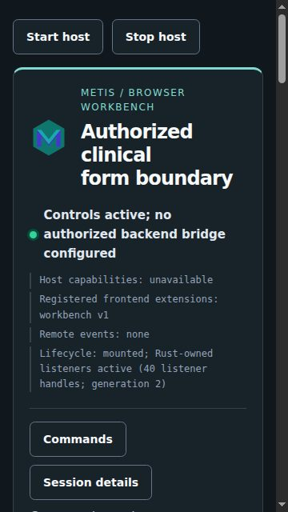
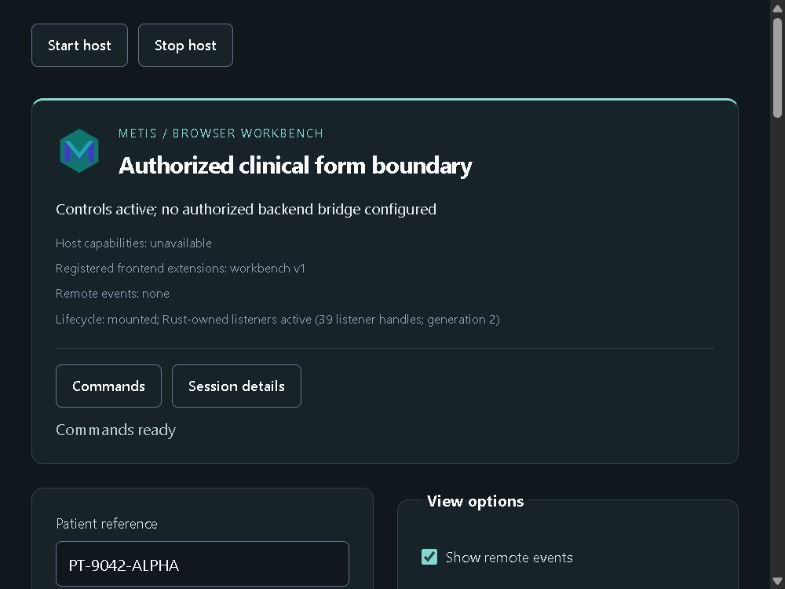
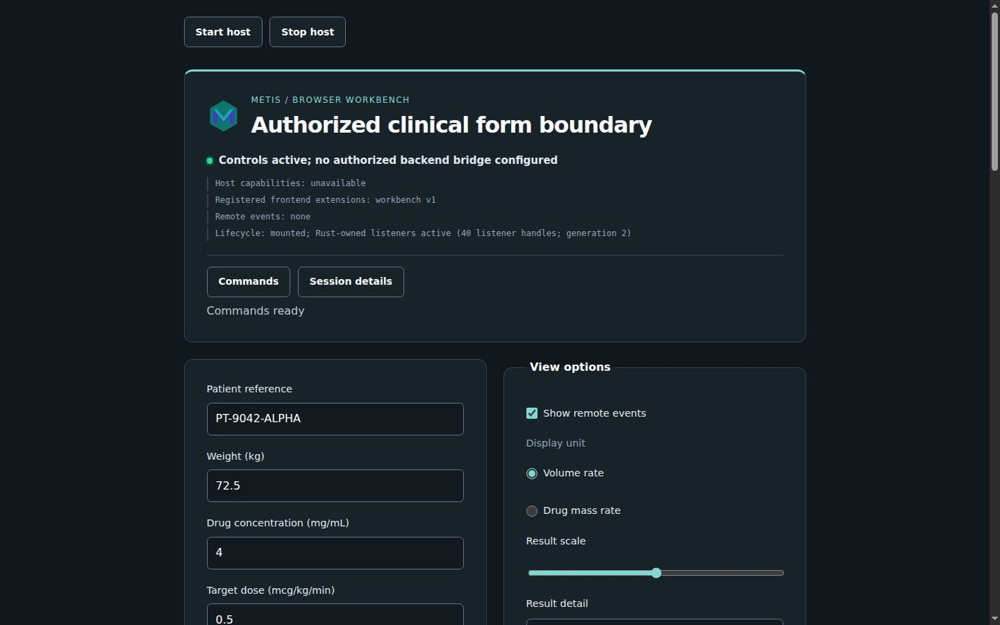
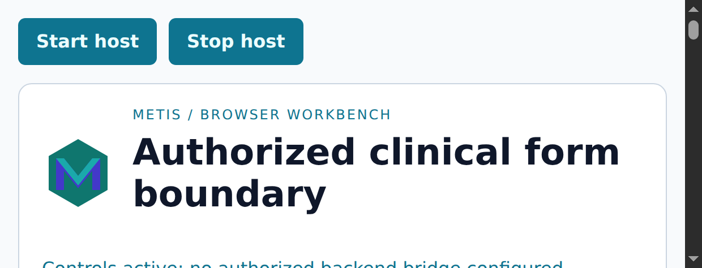
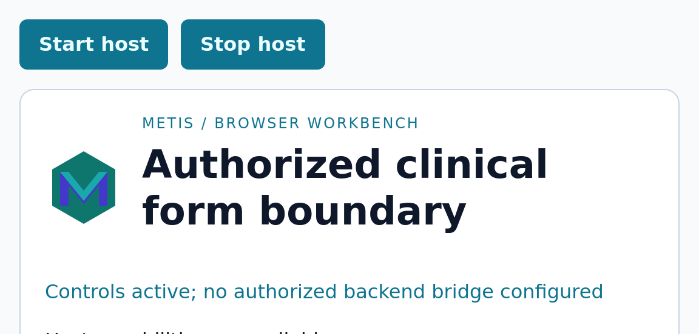

# Browser responsive

[Browser manual](../browser.md)

## Responsive runtime capture

The workbench uses a charcoal and teal dark palette, a compact utility bar,
and a separate title and diagnostic text hierarchy. The primary status line
leads with a state indicator; the capability, extension, event and lifecycle
lines below it read as a monospace diagnostic log, so they are not mistaken
for content. Cards rest on a slightly darker page with a soft elevation, and
each section heading carries an accent rule. Outlined secondary buttons keep
the filled treatment for an enabled backend submission, which is also taller.
The command menu lists one command per row with its keyboard shortcut drawn
from the item's `aria-keyshortcuts` attribute, so the visible hint and the
announced shortcut cannot differ. Shared panel padding scales from `1.25rem`
to `2rem`; controls retain their `44px` minimum target. Selected explorer
entries use the information palette rather than the success palette,
reserving success color for accepted operations.

Every color token is declared once as `light-dark(light, dark)`. A theme
chooses only the color scheme that resolves the tokens: `light` and `dark`
fix it, `system` sets `light dark` so the browser follows the operating-system
preference, and high contrast replaces the tokens outright. This removes the
second copy of the light palette the system mode previously repeated inside a
media query.
Light, system and high-contrast modes retain the same layout and focus rings.

The page uses a bounded responsive grid. At widths below `700px`, the form and
options stack in one column with `1rem` page padding; wider viewports use two
`minmax(0, 1fr)` columns inside a `960px` content bound. Grid items accept
long status and clinical strings without widening the page, and the host
buttons use the same narrow-viewport padding. Option rows and the result-scale
slider expose a `44px` CSS hit target so their labels remain usable on touch
and keyboard layouts. The CSS contract test checks these declarations.

Playwright 1.56.1 driving Chromium 141.0.7390.37, with classic 15px scrollbars
enabled so the viewport matches a desktop window, captured the generated
workbench at `360×640`, `800×600` and `1440×900` CSS pixels with device scale
`1`. The
runtime manifest records the exact card rectangles, grid columns, scroll
extents and interactive target rectangles in
[`browser-layout-metrics.json`](../images/browser-layout-metrics.json), bound to
the stylesheet SHA-256 recorded in that file. The captures show the narrow
single-column layout, the two-column fixture and the bounded wide layout:

The measured pages have no horizontal overflow; every card and required
interactive target ends inside the viewport, and the option rows and slider
measure `44px` high at all three widths. The runner now exposes a bounded
device-scale override and records the effective ratio in each trace. A
configured browser endpoint is still required to produce live scale-2
screenshots; physical monitor transitions and platform fractional-scale cases
remain V04/V05 host evidence.

### Hosted device-scale capture

The manually dispatched [Metis verification run](https://github.com/ryancinsight/metis/actions/runs/34770298938)
captured the same workbench at device scale `2` in Chromium 152.0.7977.82 and
Firefox 155.0. The traces report effective `devicePixelRatio` `2`, CSS
viewports of `620×237` and `576×276`, four stop/remount cycles, zero stopped
listener handles, 31 remounted listener handles, zero pending requests and a
closed WebDriver session. Safari 26.6.2 is the scale-`1` control in the same
matrix. The [revision-bound provenance record](../images/metis-browser-device-scale.json)
contains the artifact links, screenshot hashes and sanitized lifecycle results.

These are hosted browser-window captures of the format-neutral Metis workbench;
they verify scale negotiation and lifecycle behavior. DICOM decoding and
patient-image presentation remain RITK-owned and are shown in the [RITK
application gallery](../applications.md#real-dicom-application-evidence).

[Input Events]: https://w3c.github.io/input-events/
