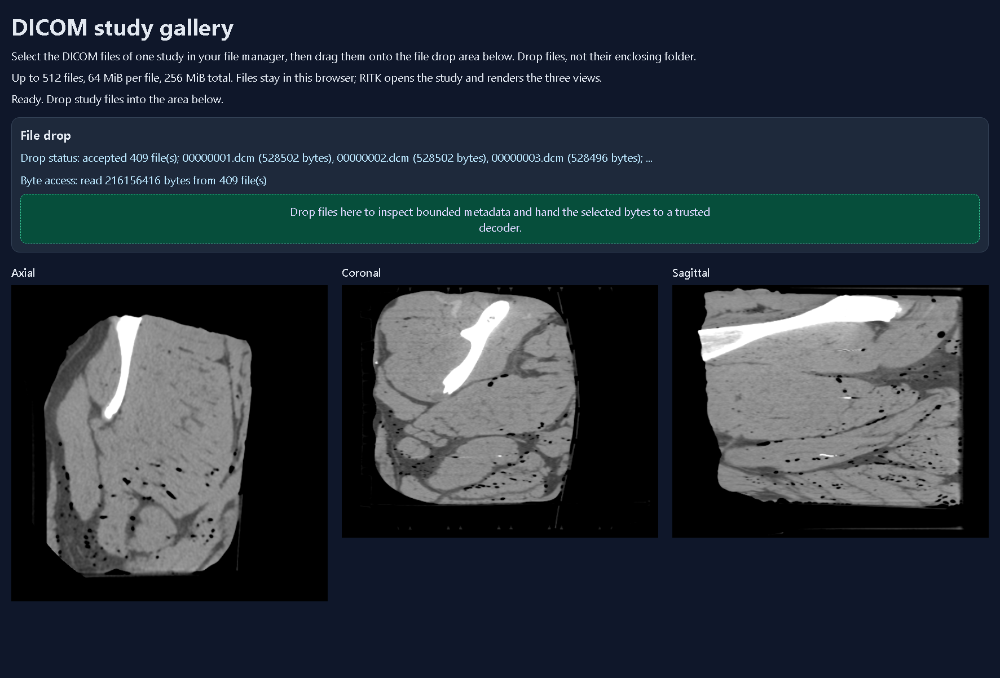
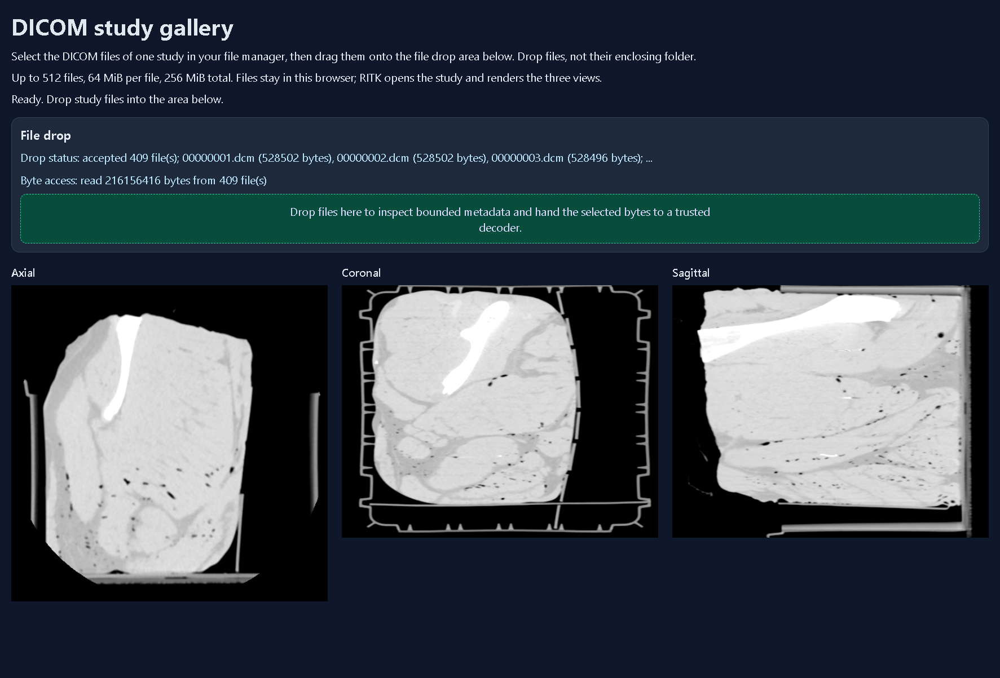

# Browser saved study

[Browser manual](../browser.md)


## Drop a study into the gallery

The [RITK consumer gallery](https://github.com/ryancinsight/ritk/tree/main/crates/ritk-snap/web/gallery)
places the mounted Metis file drop area beside three RITK canvases. Metis
supplies a generic **Choose files** control and a source-neutral bounded byte
handoff; the RITK package and page are passed explicitly to
`scripts/browser.py build` with `--consumer-package` and `--consumer-gallery`.
The RITK consumer configures the visible DICOM wording and
`.dcm,application/dicom` filter after mounting, then selects the study's files
in the browser chooser or drags those files from the file manager onto the area.
Do not select or drop the enclosing folder or its license/readme files. The
chooser is a user-activated HTML5 `change` event. Moirai captures its bounded
browser `File` handles and Metis reads the same source-neutral batch used by
drag/drop; no browser path or native filesystem authority crosses the host
boundary. The page does not fetch a study or synthesize drop events. RITK owns
classification, decoding, geometry and viewer state; Metis retains its
512-file, 64 MiB/file and 256 MiB/batch limits. The [RITK DICOM workflow](https://github.com/ryancinsight/ritk/blob/main/docs/manual/dicom-workflow.md)
contains the saved-study command and actual image evidence.

For a saved study, choose all files from one series and wait for **Byte access**
to report the accepted count and bytes. RITK then reports the decoded study and
the three canvases become non-black. Selecting an empty or over-budget batch
produces a typed rejection without handing bytes to the decoder.

Consumer pages can select an explicit, bounded mode without changing the
format-neutral host. Pass one or more validated `KEY=VALUE` pairs to the
generic runner; it appends them to the same-origin gallery URL and leaves their
meaning to the consumer:

```powershell
python scripts/browser_drop.py --driver-url http://127.0.0.1:9517 `
  --input chooser --page-query renderer=webgpu `
  --files D:/atlas/repos/ritk/test_data/2_head_mri_t2/DICOM --pattern '*.dcm' `
  --oracle output/browser/mri-oracle.json --consumer-revision <ritk-revision>
```

The runner accepts at most eight ASCII parameters with bounded keys and values,
rejects duplicates and delimiters, and still validates the same-origin page
before transfer. `renderer=webgpu` is therefore a RITK choice; Métis does not
interpret it or add DICOM policy.

Moirai reads each caller-sized browser `Blob` slice through a local object URL
response stream. For the first bounded read of a file no larger than 1 MiB, the
provider uses the browser `File.arrayBuffer()` API directly without allocating
beyond the provider bound. The hosted replay
[run 35089121864](https://github.com/ryancinsight/ritk/actions/runs/35089121864)
exercises that path with the real 94-file MRI-DIR T2 study. Chromium 152 and
Firefox 155 complete the bounded transfer. Safari 26.6.2 accepts the 94-file
chooser request, then WebKit rejects the first 529,864-byte
`File.arrayBuffer()` read. The current WebKit artifact is
[10445741511](https://github.com/ryancinsight/ritk/actions/runs/35089121864/artifacts/10445741511);
RITK's [cross-engine provenance](https://github.com/ryancinsight/ritk/blob/main/docs/manual/images/dicom-metis-real-browser-mri-cross-engine.json)
binds the trace, sandbox logs and canonical failure capture.
Larger files and positioned continuation reads retain the sliced object-URL
response stream. The gallery's strict content security policy permits `blob:`
only in `connect-src` for that bounded local read; network origins remain
explicit and `object-src` stays disabled.

The host retains the provider's read error in **Byte access** and never forwards
an incomplete batch. On an automated chooser failure, the runner records bounded
comparisons of the selected file's original `File.arrayBuffer()`, bounded slice,
`FileReader` and blob-URL stream reads. In current run 35089121864 Safari reports
`NotReadableError` for the first three APIs and `TypeError` for the stream; the
host independently reads the 529,864-byte file and verifies its expected
SHA-256. These controls preserve the failed result and original screenshot; they
do not supply replacement bytes to the consumer.

The current Safari run records WebKit WebContent denials for
`file-read-data` and
`file-issue-extension`, plus a WebKit Networking `file-read-data` denial on the
selected file. SafariDriver accepts `Automation.setFilesToSelectForFileUpload`
before those denials. The exact SafariDriver/WebKit authorization defect
remains unresolved; Metis and Moirai cannot grant browser sandbox access. The
generic host preserves the failure, and RITK receives no partial study.

### Use the saved-study chooser

The chooser path was exercised on 2026-09-12 with the packaged RITK viewer and
the public MRI-DIR CT study. Selecting all 409 `.dcm` files from
`test_data/3_head_ct_mridir/DICOM/` produced `accepted 409 file(s)` and
`Byte access: read 216156416 bytes from 409 file(s)`. RITK then reported ready
frames on the axial, coronal and sagittal canvases. Their intrinsic frames were
512 × 512, 512 × 409 and 512 × 409 pixels, respectively, and the live viewport
showed non-black CT anatomy in every plane. The first three filenames in the
bounded status preview were `00000001.dcm` (528502 bytes), `00000002.dcm`
(528502 bytes) and `00000003.dcm` (528496 bytes).

This run used an automation file chooser to select real files from disk; it did
not synthesize a `DataTransfer` or embed image data. The public series is the
same source used by the [reviewed gallery capture](../images/browser-gallery.webp)
and the [RITK orthogonal PNG baseline](https://github.com/ryancinsight/ritk/tree/main/docs/manual/images).
The chooser contract is format-neutral in Metis; RITK owns the DICOM pixels and
viewer semantics. Physical file-manager drag input remains a separate host
claim.

The same chooser also opened the saved MRI-DIR T2 study in
`test_data/2_head_mri_t2/DICOM/`: 94 real files, 49,807,236 bytes, and
non-black axial, coronal and sagittal views. RITK reported intrinsic frames of
512 × 512, 512 × 94 and 512 × 94 pixels, with the axial slice at 47/94 and the
orthogonal slices at 256/512. This confirms that the chooser path carries a
second saved modality through the same bounded transfer; modality semantics
remain in RITK.

The recorded cross-engine captures show the real anatomy rendered through this
format-neutral host: [Chromium gallery](https://github.com/ryancinsight/ritk/blob/main/docs/manual/images/dicom-metis-real-browser-mri-cross-engine-chromium.png)
and [Firefox gallery](https://github.com/ryancinsight/ritk/blob/main/docs/manual/images/dicom-metis-real-browser-mri-cross-engine-firefox.png).
The current standalone-lock replay (2026-09-22) is recorded in RITK PR
[#605](https://github.com/ryancinsight/ritk/pull/605), merged as
`29c51440ad4d33ab4109dd665683b7ef5bf45198`; its standalone lock was delivered
by RITK PR [#604](https://github.com/ryancinsight/ritk/pull/604), merged as
`5e2b74d0ac7550870c147c43225b36757b9b0663`, and its exact replay source is
`e88a94219fac9f07339393da2cd0e7a19164f93b`. All six Metis packages resolve at
`1b10541c2ef7a849e6ff66a3c778874bdf96de7b` and fifteen Moirai packages at
`b77239dd10bcaf803394c26255c462bc858c1340`. The standalone Cargo.lock SHA-256
is `d0d6abd6baf3f7d45943e9d1d3f85a2158b7dae605d3ec23ec07981b8b17a9cd`. It
reads all 94 saved files (49,807,236 bytes), reproduces the revision-bound
1280 × 800 MRI frame with SHA-256
`85071f20ca11cb4a9b2524db0a53b21695b7e93141831e7e0ab293c42fbcd582` and
411,413 non-black pixels, and rejects an invalid study. The locked replay's
executable digest is
`7f81c6fc3d2e76c7e28d603fbaad3eece1fb67c694b7b97bf4ff6c7dc3325484`;
the [RITK replay provenance](https://github.com/ryancinsight/ritk/blob/main/docs/manual/images/dicom-metis-real-mri.json)
is authoritative for the example digest, storage-reuse oracles and physical
spacing carried into the native and browser presentation boundaries.
The current hosted browser run [35759891764](https://github.com/ryancinsight/ritk/actions/runs/35759891764)
exercises the same 94-file study against Metis `1b10541c2ef7a849e6ff66a3c778874bdf96de7b`.
Chromium raster, Chromium-window, Chromium MIP projection, Chromium responsive,
Firefox raster and Firefox responsive lanes pass the real study with their
RGBA, semantic and teardown oracles. WebKit accepts all 94 chooser paths and
49,807,236 bytes, then rejects the bounded whole-file read; Chromium WebGPU
reports no usable adapter on the hosted runner. These capability residuals and
their source captures are recorded in the [RITK cross-engine provenance](https://github.com/ryancinsight/ritk/blob/main/docs/manual/images/dicom-metis-real-browser-mri-cross-engine.json).
RITK scans and decodes DICOM and owns the clinical pixels; Metis supplies the
format-neutral chooser, bounded handoff and canvas host.

Build RITK's locked WASM library and package it with the pinned wasm-bindgen CLI
as described in the RITK browser workflow linked above. From Metis, include that
fresh package when building the gallery:

```powershell
python scripts/browser.py build `
  --consumer-package D:/atlas/target/wasm-bindgen/ritk-snap `
  --consumer-gallery D:/atlas/repos/ritk/crates/ritk-snap/web/gallery
python -m http.server 8000 --bind 127.0.0.1 --directory output/browser
```

Open `http://127.0.0.1:8000/gallery.html`. The RITK package must be rebuilt after
its Metis dependency changes; an old package can still embed the old file limit.
Without the package, the page reports a viewer startup failure.

The [capture](../images/browser-gallery.webp) and [trace](../images/browser-gallery.json)
record the public CC BY 4.0 MRI-DIR CT phantom: 409 files, 216,156,416 bytes.
The browser delivered trusted `dragenter`, `dragover` and `drop` events through
Chromium's file-backed input protocol. Every file's content hash matched the
local fixture; each canvas's complete RGBA hash matched RITK's existing reference
PNG, including pixel positions, intensity and alpha. The same browser run rejects
file-count, per-file-byte and batch-byte overflow before the evidence reader
reads content, and verifies that the rendered pixels remain unchanged. The expected values live
in the [consumer oracle](../images/browser-gallery-oracle.json), derived from
RITK's `dicom-metis-real-browser-orthogonal.json` and its three PNGs.

The committed trace was rerun on 2026-09-11 with the current Metis mainline
(`0f7093e6701af4ab4a3779925206d7a31f964319`) and RITK consumer revision
`0bad9eb2c77b91e57fff3e9dc472a42201e061aa`. Edge 153.0.4234.19 negotiated a
W3C session, delivered trusted file-backed drag events, matched every file and
RGBA oracle, rejected all three overflow cases, captured the complete window
and each canvas, and closed the session with `session_closed: true`.
This closes the configured Chromium/Edge CDP drag gallery run; it does not
claim physical file-manager input. The standard chooser matrix is recorded
below as a separate transport path.

The automated runner also supports the browser's standard file chooser. This is
the cross-engine path: WebDriver sends newline-separated absolute paths to the
real `#file-input`, and the browser emits the trusted `change` event that the
Rust-owned listener consumes. It does not use Chromium CDP and it does not
place file bytes in the protocol request. Select `--engine chromium`,
`--engine firefox` or `--engine webkit`; the default browser names are Chrome,
Firefox and Safari, with `MicrosoftEdge` admitted as the Chromium override.

```powershell
python scripts/browser_drop.py --driver-url http://127.0.0.1:9515 `
  --engine firefox --input chooser `
  --files D:/atlas/repos/ritk/test_data/2_head_mri_t2/DICOM --pattern '*.dcm' `
  --oracle output/browser/mri-oracle.json --consumer-revision $revision
```

Use `--engine webkit --input chooser` with a Safari WebDriver endpoint, or
`--engine chromium --browser-name MicrosoftEdge --input chooser` with Edge.
The trace records the selected engine, `change` event, per-file content hashes,
the exact RITK RGBA canvas oracles, three sparse-file admission rejections and
closed-session state. `--input chromium` remains the explicit Chromium CDP drag
probe; `--input manual` observes a physical file-manager drop and cannot make a
portable cross-engine automation claim.

The revision-bound hosted chooser matrix is [RITK workflow 35500085568](https://github.com/ryancinsight/ritk/actions/runs/35500085568),
rebuilt against RITK `f46d30091cac1ace12bb339d7421ac0c339ebf49`, Metis
`ab239d70bb561cbe665f852cc55ecbe4275be349` and Moirai
`2a54e010532f76c88027fec8a468620c92fe66b3`. Chromium 152 and Firefox 155
each accepted the real 94-file MRI-DIR T2 study (49,807,236 bytes), matched
every file hash and all three RITK RGBA canvas oracles, rejected the bounded
count, per-file and batch overflow probes, dispatched trusted pointer and wheel
actions, exercised focused `=`/`-` cine-rate keydown/keyup pairs with explicit
repeat handling, and closed with `session_closed: true`. The same run's
Chromium projection artifact [10601916572](https://github.com/ryancinsight/ritk/actions/runs/35500085568/artifacts/10601916572)
passes the real MIP surface: 512 × 512, 110,028 non-black pixels,
`data-ritk-projection-statistic="MIP"`, 21 interactive listeners and a
display-only projection canvas. The actual real-study MIP figure and complete
per-engine provenance are owned by [RITK's manual evidence](https://github.com/ryancinsight/ritk/blob/main/docs/manual/dicom-workflow.md#add-a-display-only-scalar-projection-canvas).

Safari 26.6.2 in the same run accepted chooser paths but its selected-file
browser read was rejected by the host before RITK could present a study. It
therefore has no DICOM or keyboard claim. Chromium WebGPU likewise reported no
browser adapter and made no raster fallback claim. The WebKit file-backed read,
physical file-manager input, native dialogs/processes, WebGPU and
provider-private resource observations remain separate acceptance gates.




Reproduce with a matching local Chromium WebDriver already listening on port
9515 (use `--browser-name chrome` for Chrome):

```powershell
$revision = git -C D:/atlas/repos/ritk rev-parse HEAD
python scripts/browser_drop.py --driver-url http://127.0.0.1:9515 `
  --browser-name MicrosoftEdge --input chromium `
  --device-scale 2 `
  --files D:/atlas/repos/ritk/test_data/3_head_ct_mridir/DICOM --pattern '*.dcm' `
  --oracle docs/manual/images/browser-gallery-oracle.json --consumer-revision $revision
```

Use `--input manual` to perform the file-manager drag yourself into the opened
browser. The same bounded observer checks event trust, file identities and
rendered pixels; it never injects the input in manual mode. Each run replaces
`output/browser/drop/trace.json` and fixed capture names, closes its driver
session and stops its local server. Browser waits terminate within 60 seconds.
Browser chrome is excluded. The trace is automated file-backed browser input
evidence; physical mouse/file-manager input remains a separate claim. The
hosted chooser result above is the authoritative cross-engine status.

To capture the canvas interaction on the same loaded study, add a paired
format-neutral trace and the consumer's opaque attribute names. The file-drop
trace still records the file manifest, byte count and RGBA oracle; the paired
trace records one trusted pointer drag and wheel action per canvas, the seven
consumer attributes, full-window and element screenshots, and input-source
release:

```powershell
python scripts/browser_drop.py --driver-url http://127.0.0.1:9515 `
  --browser-name MicrosoftEdge --input chromium `
  --device-scale 2 `
  --files D:/atlas/repos/ritk/test_data/3_head_ct_mridir/DICOM --pattern '*.dcm' `
  --oracle docs/manual/images/browser-gallery-oracle.json `
  --consumer-revision $revision `
  --canvas-trace output/browser/runtime/chromium-canvas.json `
  --canvas-attribute data-ritk-load-state `
  --canvas-attribute data-ritk-frame-state `
  --canvas-attribute data-ritk-axis `
  --canvas-attribute data-ritk-slice-index `
  --canvas-attribute data-ritk-slice-count `
  --canvas-attribute data-ritk-frame-width `
  --canvas-attribute data-ritk-frame-height
```

Validate the paired trace from the RITK checkout with
`--validate-browser-trace`. The host runner does not interpret those names or
values; RITK owns their meaning and the DICOM/viewer assertions. A missing
attribute, malformed action, incomplete screenshot set or unreleased input
source fails the consumer validator.

Add `--keyboard-trace` when the paired run also needs keyboard-focus evidence.
The runner focuses each named canvas, sends one trusted W3C `ArrowDown`
keydown/keyup pair, and records the target, `key`, `code`, repeat flag and four
modifier flags in the bounded event trace. This remains a format-neutral
transport check; RITK assigns shortcut meaning and validates the records with
`--require-keyboard`. Keyboard mode also records one `after-keyboard` semantic
canvas snapshot before the pointer and wheel actions, allowing RITK to compare
wheel progression with the state immediately before that wheel.

The optional profile `--keyboard-trace cine-rate` records four trusted keyboard
actions. Chromium sessions use the Chrome DevTools Protocol
[`Input.dispatchKeyEvent`](https://chromedevtools.github.io/devtools-protocol/1-3/Input/#method-dispatchKeyEvent)
command with explicit `autoRepeat`; other browser families retain W3C actions
and surface a missing repeat event as a trace failure. The profile holds the
printable `=` key (`code` `Equal`) across calls to record an initial keydown and
a repeated keydown before release, then does the same for `-` (`code` `Minus`).
Each action records its transport, focus, expected keydown repeat state and the
actual trusted browser events. The trace adds semantic canvas snapshots and
element screenshots named
`after-keyboard`, `after-repeat`, `after-decrease` and
`after-decrease-repeat`. A consumer that exposes a rate semantic (RITK uses
`data-ritk-cine-fps`) includes that attribute in the trace request and owns the
rate assertions. The default profile remains `ArrowDown`, so existing
navigation traces retain their contract.

```powershell
python scripts/browser_drop.py --driver-url http://127.0.0.1:9515 `
  --browser-name MicrosoftEdge --input chromium `
  --device-scale 2 `
  --files D:/atlas/repos/ritk/test_data/2_head_mri_t2/DICOM --pattern '*.dcm' `
  --oracle output/browser/mri-oracle.json `
  --consumer-revision $revision `
  --canvas-trace output/browser/runtime/chromium-keyboard-canvas.json `
  --keyboard-trace `
  --canvas-attribute data-ritk-load-state `
  --canvas-attribute data-ritk-frame-state `
  --canvas-attribute data-ritk-axis `
  --canvas-attribute data-ritk-slice-index `
  --canvas-attribute data-ritk-slice-count `
  --canvas-attribute data-ritk-frame-width `
  --canvas-attribute data-ritk-frame-height
```

The local command exercises real file-backed input from the saved public
MRI-DIR study. Hosted run [34973438029](https://github.com/ryancinsight/ritk/actions/runs/34973438029)
validates the `cine-rate` keyboard profile on Chromium 152 and Firefox 155:
trusted `=`/`-` events move each canvas through `12 -> 13 -> 13 -> 12 -> 12`
frames per second, while repeated keydowns leave the rate unchanged. Safari's
bounded read failed before its canvases were presented, so no Safari DICOM or
keyboard claim is made; the exact hosted traces and actual galleries are
recorded in [RITK's manual evidence](https://github.com/ryancinsight/ritk/tree/main/docs/manual/images).

The paired Edge run at Metis revision
`1321bd434500744e4d80fb906d10d9aa74590003` produced six semantic snapshots:
the 409-slice axial view moved from slice 204 to 203, and the coronal and
sagittal views moved from slice 256 to 255 after the trusted wheel actions.
All three remained presented at their expected dimensions. The paired capture
runs before the bounded overflow probes, and the rejection checks compare
against the post-input pixel baseline. The revision-bound trace is
[`browser-gallery-canvas.json`](../images/browser-gallery-canvas.json); its eight
screenshots are the paired initial/after-input window and canvas captures. This
is the same public CT study as the file-drop trace, not a synthetic image.

The final browser window below shows the three live orthogonal views after the
input actions. The element captures preserve the individual canvases for visual
inspection: axial [initial](../images/browser-gallery-canvas-ritk-snap-axial-initial.png)
and [after input](../images/browser-gallery-canvas-ritk-snap-axial-after-input.png),
coronal [initial](../images/browser-gallery-canvas-ritk-snap-coronal-initial.png)
and [after input](../images/browser-gallery-canvas-ritk-snap-coronal-after-input.png),
and sagittal [initial](../images/browser-gallery-canvas-ritk-snap-sagittal-initial.png)
and [after input](../images/browser-gallery-canvas-ritk-snap-sagittal-after-input.png).



[Input Events]: https://w3c.github.io/input-events/
