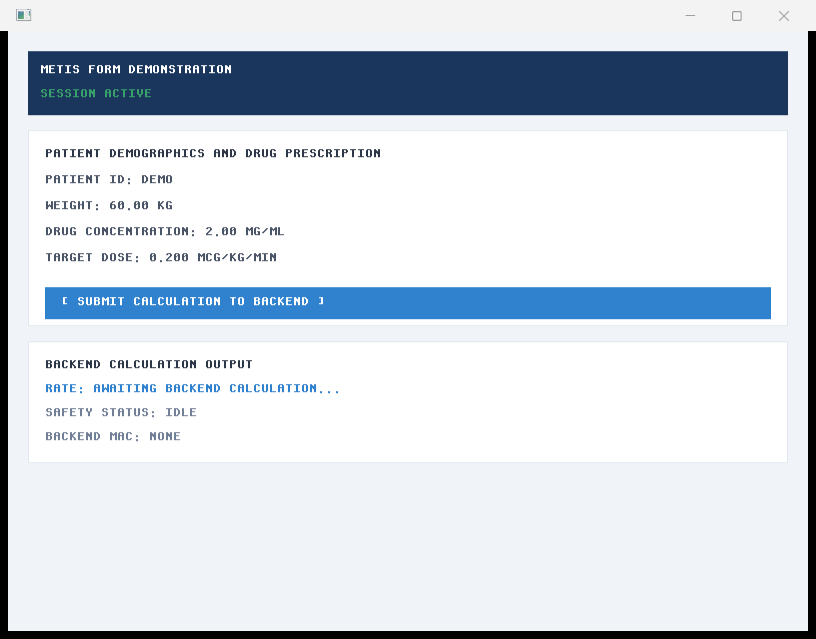
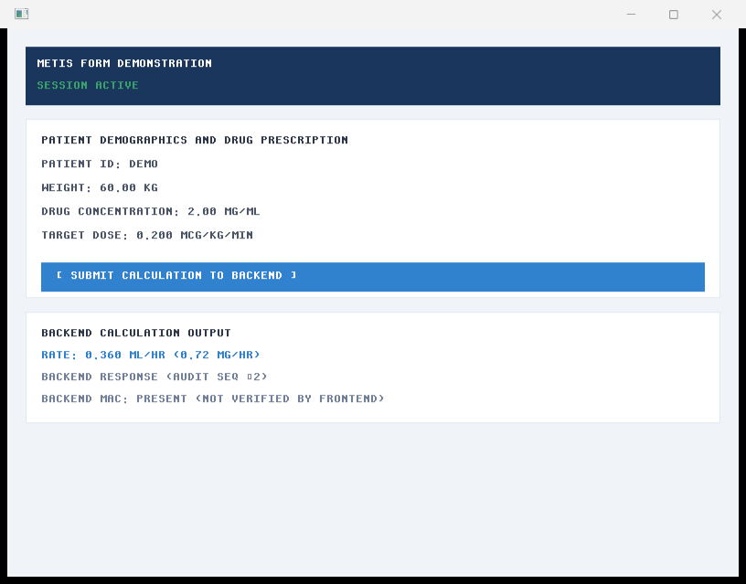
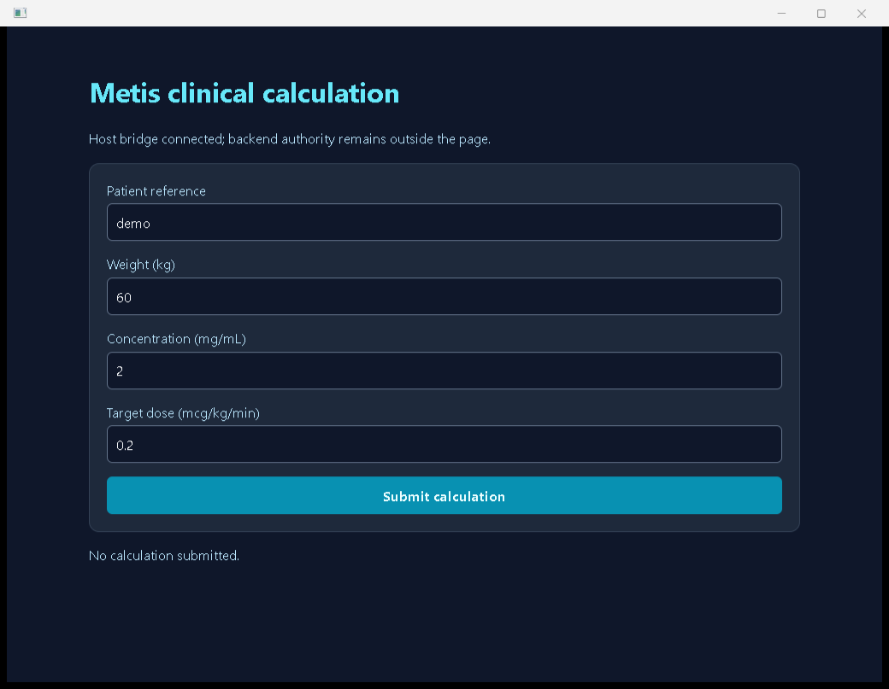
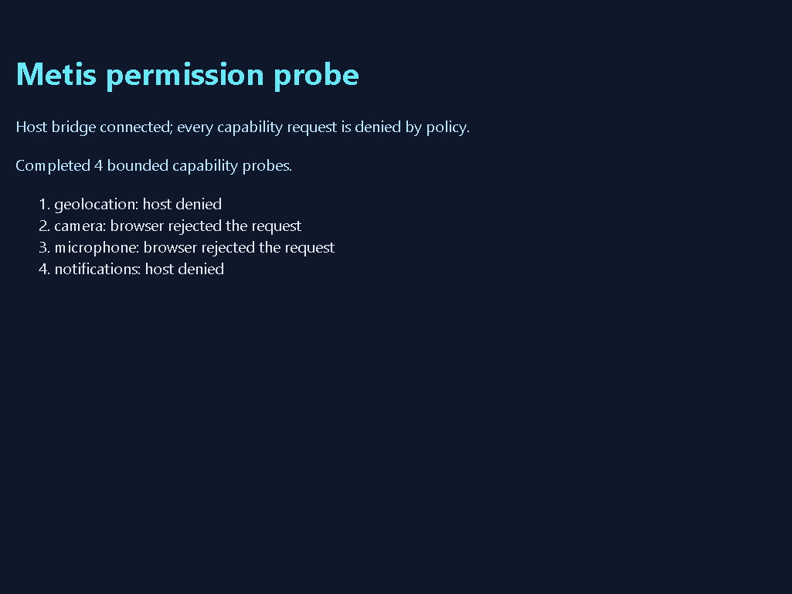
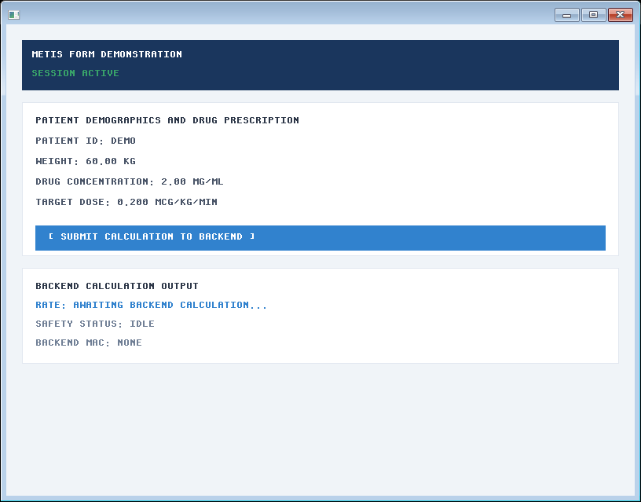
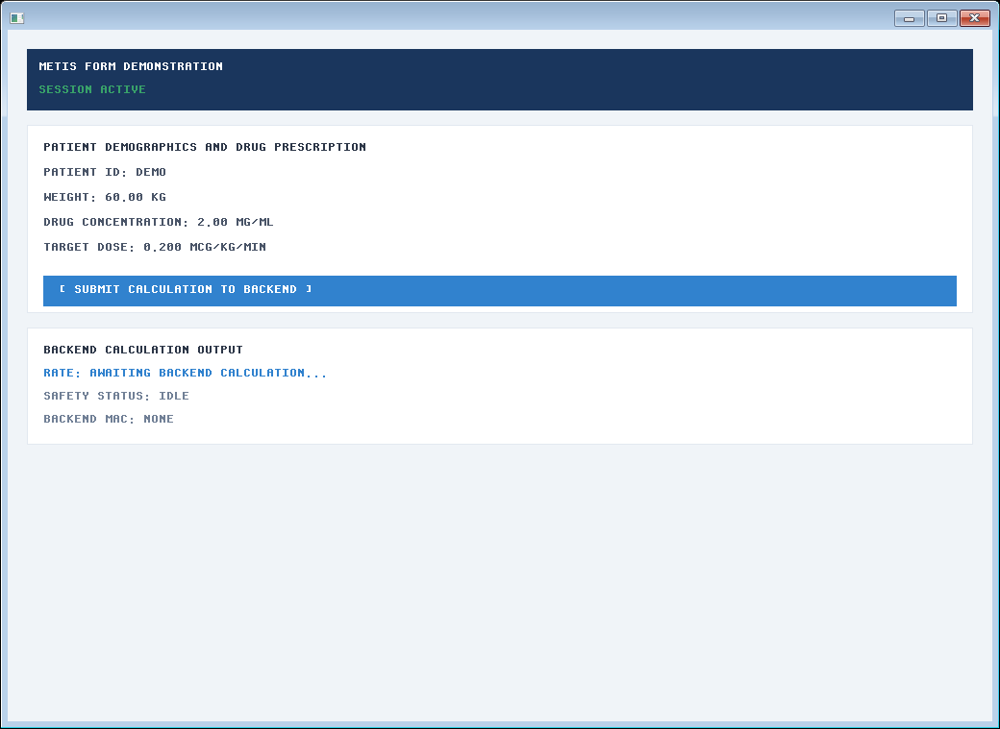

> Windows build/run commands require the [current Rust asset preparation](../../../crates/metis-app/src/frontend/webview/manual.md) before compilation. Capture records retain their cited revisions.

## Captured Windows workflows

The following captures were taken from the production `metis-app` executable
built at revision `0c8bcc32911c087bf686588cd4a7c56a29d0b92e` on
`x86_64-pc-windows-msvc`. The installed WebView2 runtime was
`152.0.4191.66`. Exact image hashes, window sizes and action traces are stored
in [`native-captures.json`](../images/native-captures.json).

### Software framebuffer window

The initial native window is an 800×600 client area inside an 816×639 outer
window. It shows the production form, an active supervised session and the
waiting backend state:



Pressing **Enter** while the window is focused submits the same values through
the private pipe. The captured response is input-sensitive and includes audit
sequence 2 and a present backend MAC:



### Packaged WebView2 window

The WebView2 page is a 1024×768 client area inside a 1040×807 outer window. The
initial capture shows the local HTML/CSS package and the connected host bridge;
the page still reports that no calculation has been submitted:



A trusted operating-system pointer click on **Submit calculation** sends the
typed message through the WebView2 callback and private backend pipe. The page
then displays `Rate 0.36 mL/hour; drug 0.72 mg/hour; audit 2`:


The packaged page also exposes the four theme modes used by the browser
workbench: **System preference**, **Light**, **Dark** and **High contrast**.
Changing the selector updates only the document's `data-metis-theme` attribute
and local CSS variables. It does not send a bridge message or alter backend
authority. The packaged executable also has a bounded capture role, which
selects the initial mode before the page is shown and writes the provider's
`CapturePreview` PNG after the first event batch:

```powershell
cargo run --locked -p metis-app -- --metis-webview-theme-capture C:\captures\metis-webview-theme-light.png light 60 2 0.2
```

Repeat the command with `system`, `light`, `dark` and `high-contrast` (and a
different absolute `.png` path for each mode). The four inspected captures
below came from the packaged Windows executable; each contains the rendered
form and its selected mode, rather than a stylesheet or DOM-only assertion:

| Mode | Capture | PNG bytes | Dimensions | SHA-256 |
| --- | --- | ---: | ---: | --- |
| System preference | [webview-theme-system.png](../images/webview-theme-system.png) | 12,991 | 1025×769 | `15c88ffd69531b815e71e28951b2b2bb09e274f2dd6c4c7bc6155b684499e6a6` |
| Light | [webview-theme-light.png](../images/webview-theme-light.png) | 12,529 | 1025×769 | `ec3caec1fd604ffc1272cfdffc958661e40ed90057636c487c601fc601ab8b7e` |
| Dark | [webview-theme-dark.png](../images/webview-theme-dark.png) | 12,492 | 1025×769 | `75730d4d78b9b8cf499a15afb8d228c1b2ef71ecac9a0e081789ee582d418694` |
| High contrast | [webview-theme-high-contrast.png](../images/webview-theme-high-contrast.png) | 12,802 | 1025×769 | `d1523c8f8bb5daff330ac90131e7b316ce6ce4c89d94ef043a923c4db827b160` |

The system capture follows the host preference on the capture machine; the
other three captures prove the explicit palettes. For a manual interaction
check, launch the ordinary `--metis-webview` command above, focus **Theme**, select each option,
and inspect the page background, surface, text, focus ring and result status
before submitting the calculation. These images establish visible palette
selection through the packaged provider. They do not establish screen-reader
behavior, installed-IME behavior, or physical high-DPI transitions.

The packaged page also exposes a local command surface: an application
navigation landmark contains a toolbar, a **Commands** menu and a
**Focus patient reference** action. The menu's dark and system theme actions
update the existing theme selector without crossing the WebView2 bridge. The
menu state is reflected through `aria-expanded`, `aria-hidden` and a live
status; Escape closes it and restores focus to the trigger. These actions are
presentation controls only. They do not grant page script host objects or
replace the supervised calculation bridge, and this evidence does not cover
screen-reader speech or installed-IME traversal.

### WebView2 permission-probe capture

The permission-probe role loads a separate packaged page that requests
geolocation, camera, microphone and notifications and reports the host's typed
denials. Its capture form asks WebView2 for a PNG through `CapturePreview`, so
the inspected pixels do not depend on GDI or whether the window is visible to
the desktop compositor:

```powershell
cargo run --locked -p metis-app -- --metis-webview-permission-probe-capture C:\captures\metis-permission-probe.png 60 2 0.2
```

The output path is an absolute `.png` path. The host waits for the page's typed
`permission_probe_complete` message after all four bounded requests settle,
writes the WebView2-owned preview, and closes the supervised session. The
current visual run uses Metis revision `543edfb533be0c0422c38445174001b616c96ace`, Moirai revision
`0e2e1bbb2d81e16dd9c694ba46a9e9710e034417`, WebView2 runtime
`153.0.4234.48`, and a 1025×769 CapturePreview image. It produced 9,265 bytes
with SHA-256
`0f36794bea61fe540e7a4603b2c56d943718344c68c4e46aa3b0d839e7ab3a36` and shows
the completed four-row matrix: geolocation and notifications are host-denied,
while camera and microphone are browser-rejected on this Windows host.



The full command, observed text and digest are recorded in
[`native-captures.json`](../images/native-captures.json).

### Scoped native file reads

Native applications that need bytes from a host-selected directory use
`metis_platform::ScopedFileProvider`. The host first authorizes a
`CapabilityScope::READ_FILE` witness; the provider then opens a relative path
through Moirai's directory-handle walk. Parent components, symlinks,
directories and files larger than 64 MiB are rejected before bytes are
returned. The provider has no DICOM knowledge and does not expose an
unrestricted frontend path; RITK remains the owner of DICOM scanning and
decoding.

The denial and byte-value contract is executable in the platform test suite:

```powershell
cargo nextest run --locked -p metis-platform --lib
```

The `scoped_file` tests cover a successful nested read, traversal and size
rejection, and a host-policy token without `READ_FILE` scope. This is provider
security evidence; it does not substitute for the real RITK MRI captures
linked in the [DICOM workflow manual](https://github.com/ryancinsight/ritk/blob/main/docs/manual/dicom-workflow.md).

### Scoped native process execution

Native applications that need a host sidecar use
`metis_platform::ScopedProcessProvider`. The host supplies one absolute regular
executable, a finite value allowlist for every argument and, when required, a
bounded explicit environment. A caller must present a
`CapabilityScope::RUN_PROCESS` witness. The provider passes operating-system
arguments directly, clears the environment by default and never accepts a
shell command string or a browser-selected executable path.

The provider caps stdout, drains the opt-in Moirai stderr pipe without
returning its bytes, reports only the stderr byte count, and applies a finite
deadline followed by bounded cleanup. Rejected arguments, missing capability,
invalid paths, invalid deadlines and cleanup failures are typed errors. The
real-child platform tests cover successful stdout, stderr redaction, argument
denial, missing scope and deadline termination:

```powershell
cargo nextest run --locked -p metis-platform --lib
```

This boundary is format-neutral. RITK owns DICOM parsing, study selection and
clinical presentation after its own provider receives bytes; a sidecar does
not grant the browser arbitrary native shell access.

### Scoped native HTTP

Native sidecars that need an HTTP service use
metis_platform::ScopedHttpProvider. The host supplies a finite allowlist of
HTTP(S) origins and the caller must present a CapabilityScope::NETWORK witness.
Requests validate their absolute URL, method, headers and body before Moirai
sends them. Transport-owned hop-by-hop headers are rejected and redirects are
disabled, so a response cannot silently move to a new authority.

The provider applies finite header, request-body and response-body budgets and
a finite per-request deadline. Dropping a request future cancels the transport;
deadline expiry uses the same cleanup path. Debug output omits URL, header
values and payload bytes. The platform tests perform real loopback exchanges
against local TcpListeners and cover denial, deadline and cleanup in addition
to header, body and capability rejection. Run
cargo nextest run --locked -p metis-platform --lib.

This is a host policy boundary, not a browser or DICOM API. RITK keeps DICOM
parsing and clinical presentation in its own repository.

### Native form after a real resize

The same production `metis-app.exe` was captured before and after the host
received a real Win32 client resize from 800×600 to 1024×720. The initial and
resized frames both retain the active supervised session and form controls;
the second frame is larger because `FrontendApp::resize` rebuilt its
framebuffer and layout. The host observed 96 DPI at both sizes, and the
capture utility recorded changed pixels and exact SHA-256 digests in
[`native-resize.json`](../images/native-resize.json).





The capture session closed the supervised parent and child processes after each
workflow. These images establish the visible initial, successful and historical
geolocation-denied journeys; the four-capability matrix requires a fresh
Windows capture after this source change. They do not establish native
accessibility technology, an installed CJK IME, a physical display-scale
change, or macOS/Linux hosts. The provider-level geolocation smoke remains a
separate runtime residual because WebView2 `153.0.4234.32` did not emit its
file-origin callback within the bounded wait.
For a real application frame with saved DICOM pixels, follow the
[RITK DICOM workflow](https://github.com/ryancinsight/ritk/blob/main/docs/manual/dicom-workflow.md);
RITK owns opening and decoding those files and Métis owns this format-neutral
window and framebuffer seam.


[Windows native manual](../native.md) · [Current Rust page contract](../../../crates/metis-app/src/frontend/webview/manual.md)
