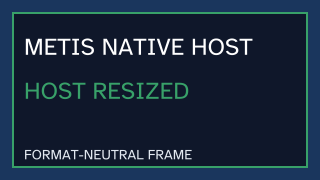

> Windows build/run commands require the [current Rust asset preparation](../../../crates/metis-app/src/frontend/webview/manual.md) before compilation. Capture records retain their cited revisions.

## Apply native display scale

Moirai reports the window's integer DPI through `WindowEvent::DpiChanged`.
The native adapter converts it with `metis_platform::DisplayScale::from_dpi`
and asks `FrontendApp` to repaint. The conversion is fixed-point and uses 96
DPI as the authored CSS baseline: 96 DPI maps to `1.000x`, 120 DPI to
`1.250x`, and 144 DPI to `1.500x`.

`LayoutViewport` carries the physical client dimensions and this scale into
`compute_layout`. Explicit pixel sizes, spacing, borders, automatic child
extents, text sizes and the submit hit rectangle use the same mapping.
Percent sizes resolve once against the physical viewport, so a percentage is
not scaled twice. A failed repaint restores the last valid scale and frame.
The fixed-point contract is exercised by the layout and rasterizer tests; the
visible captures in this manual were recorded at the host's observed 96 DPI.
Changing the operating-system monitor scale is still a physical-host test and
is reported separately from this deterministic component evidence.

## Share the native frame/event loop

Applications with a software framebuffer can use the reusable host contract
instead of writing a second wait, repaint and close loop. The application keeps
its own state and interprets the complete Moirai event batch; the host creates
the window, presents the initial frame, waits for a finite duration and closes
on a terminal event or `NativeFlow::Exit`:

```rust,no_run
use metis_core::error::MetisError;
use metis_platform::native::{
    run_native_application, NativeApplication, NativeFlow, WindowConfig, WindowEvent,
};
use metis_platform::{Color, Framebuffer};
use std::time::Duration;

struct ViewerApplication {
    frame: Framebuffer,
}

impl NativeApplication for ViewerApplication {
    type Error = MetisError;

    fn framebuffer(&self) -> &Framebuffer {
        &self.frame
    }

    fn handle_events(&mut self, events: &[WindowEvent]) -> Result<NativeFlow, Self::Error> {
        if events.iter().any(|event| {
            matches!(event, WindowEvent::CloseRequested | WindowEvent::Destroyed)
        }) {
            return Ok(NativeFlow::Exit);
        }
        Ok(NativeFlow::Continue { repaint: false })
    }
}

let mut frame = Framebuffer::new(800, 600)?;
frame.clear(Color::DARK_BLUE);
let config = WindowConfig::new("My Metis application", 800, 600)?;
run_native_application(
    &config,
    ViewerApplication { frame },
    Duration::from_millis(250),
)?;
# Ok::<(), Box<dyn std::error::Error>>(())
```

An empty batch means that the finite wait expired and is still delivered to
the application, so bounded animations or timers do not require a second event
loop. A resize handler must replace its frame before returning `repaint: true`.
The contract carries pixels and platform events only. RITK continues to scan,
decode and interpret DICOM data and supplies the resulting viewer presentation
to this boundary; no DICOM knowledge enters Metis.

### Inspect the host trace and frame

The committed `native_host_capture` example runs the real hidden
`NativeSurface` through `run_native_application`; it does not use the
in-memory test driver. Run it from a Windows checkout with a revision label:

```powershell
$revision = git rev-parse HEAD
cargo run --locked --example native_host_capture -- --output output/native-host --source-revision $revision
```

The example records every event batch and framebuffer handed to the host in
[`native-host-trace.json`](../images/native-host-trace.json). The reviewed trace
was generated at revision
`dff3bd39aefb73a5c8f78f5e999392c804ac87dd`: the hidden window reports its
320×180 readiness resize, the application replaces the blue frame with the
green resized frame and requests one repaint, then exits on the finite empty
tick. The trace includes the two presentation dimensions, deterministic pixel
checksums and representative ARGB values. The example validates the event and
presentation sequence before writing, then reads the trace back byte-for-byte.

The example generates a transient `native-host-frame.bmp`; the repository
retains the exact PNG encoding of the final framebuffer supplied to the
real host. The example decodes the
written bitmap and compares every row-major ARGB pixel to that presented
frame; the PNG is also read back byte-for-byte. The image contains the
software framebuffer only, so operating-system chrome cannot obscure the
rendered pixels. It shows the current renderer's final frame, while the trace
above stays pinned to its reviewed revision, so the trace checksums predate
the TrueType text in the image:




[Windows native manual](../native.md) · [Current Rust page contract](../../../crates/metis-app/src/frontend/webview/manual.md)
