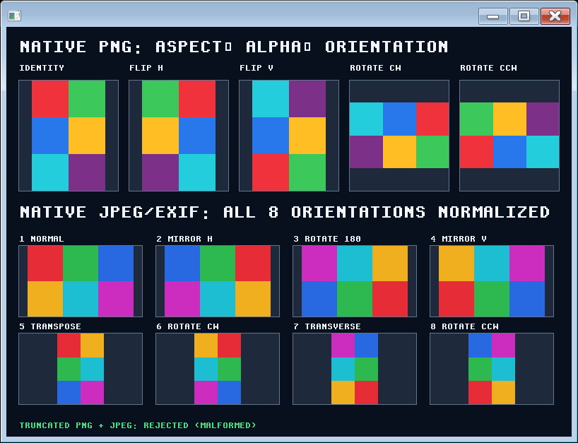

> Windows build/run commands require the [current Rust asset preparation](../../../crates/metis-app/src/frontend/webview/manual.md) before compilation. Capture records retain their cited revisions.

## Native image assets

The Windows `native_image` example decodes a repository-authored asymmetric
RGBA PNG and a JPEG color grid. The PNG row exercises five explicit display
transforms and a half-transparent magenta sample. The JPEG rows exercise all
eight EXIF orientation values, including transpose and transverse, through
the decoder. It also presents twelve-bit gray and direct-RGB samples with the
declared nearest full-range display conversion, alongside Consus arithmetic
sequential, progressive and twelve-bit lossless fixtures. Each resulting raster
is displayed with identity placement: metadata orientation has already been
applied once. Rejection labels report actual malformed-input decode results.



The [capture record](../images/native-image.json) binds the executable and source
digests to a visible Windows capture at 120 DPI. The committed PNG includes
the 818×627 window and its 800×580 client at offset (9,38). All 464,000 client
RGB pixels equal the example's independently read-back framebuffer BMP. The
PNG original and mirrored images occupy 104×156 pixels inside 140×156 bounds;
quarter-turns occupy 140×93 pixels. The remaining area is letterboxed. RGBA
`(220,55,210,128)` over RGB `(30,41,59)` produces exactly RGB `(125,48,135)`
under the shared integer source-over rule. JPEG produces opaque pixels. Six
constant-block samples are checked against an independent Pillow decode with
a one-sample bound derived from the decoder's fixed-point color coefficients.
The precision strip asserts gray `2048/4095` maps to `128` and direct RGB
`0/2048/4095` maps to `(0,128,255)` before presentation. The arithmetic
sequential/progressive pair must decode to the same three-block gray grid; the
twelve-bit arithmetic lossless fixture retains a `0/4095/2048` sample prefix
before display mapping. Orientation and aspect assertions then compare decoded
samples in their specified positions, without treating lossy JPEG as an exact
RGB encoder. The capture verifies Windows presentation on this host, including
the right and bottom edges. It does not establish heterogeneous-monitor DPI
transitions.

Build and run the demonstration from a standalone Metis checkout:

```text
cargo run --locked --example native_image
cargo run --locked --example native_image -- --visible
```

The default is a bounded hidden-window smoke. Visible mode closes on a window
close event or its 20-second deadline. The existing
`scripts/python_native_capture.py --command` runner captures the built example
with `--argument=--visible`; the configured gate runs its hidden mode under a
60-second process budget. Atlas checkouts use the existing
`scripts/cargo_overlay.py` standalone Cargo context and shared target directory.

`RasterImage::load` requires a `READ_FILE` capability and a relative path below
a `ScopedFileProvider` root. Admission rejects absolute paths, parent
components, alternate streams and the provider's link/non-regular-file cases.
`RasterImage::decode` selects PNG or JPEG from bytes, not the filename. Encoded
input is bounded to 64 MiB, each edge to 16,384 and output to 16,777,216 pixels.
The [admission ADR](../../adr/0029-image-orientation.md) specifies the format and
workspace budgets, metadata policy and independent orientation oracle.

PNG retains straight alpha and supports grayscale, RGB, RGBA and complete
palettes up to eight-bit samples, including Adam7. CRC, Adler checksum,
complete compressed-stream consumption and exact scanline length are checked.
JPEG uses the shared Consus raster decoder for eight- and twelve-bit
sequential/progressive DCT gray and RGB samples plus two- through sixteen-bit
single-component lossless gray samples. Consus maps those integer samples once
to opaque display channels with nearest full-range integer mapping; Metis
assembles opaque raster pixels and does not apply windowing, rescaling or
clinical interpretation. Wider lossless medical samples therefore remain
available to RITK with their encoded precision, while this presentation
boundary only receives its derived eight-bit display pixels.
JPEG/PNG EXIF orientation values 1–8 normalize into the returned dimensions
and pixels; malformed metadata fails. Unsupported color profiles, animation
and physical spacing fail closed. Clinical orientation remains RITK-owned.

The shared JPEG encoder includes an IJG-derived discrete cosine transform:
this software is based in part on the work of the Independent JPEG Group.

[Windows native manual](../native.md) · [Current Rust page contract](../../../crates/metis-app/src/frontend/webview/manual.md)
